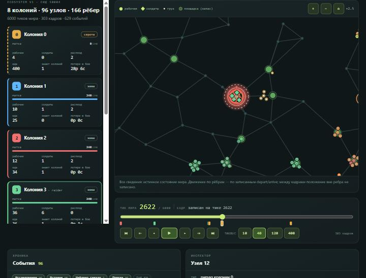
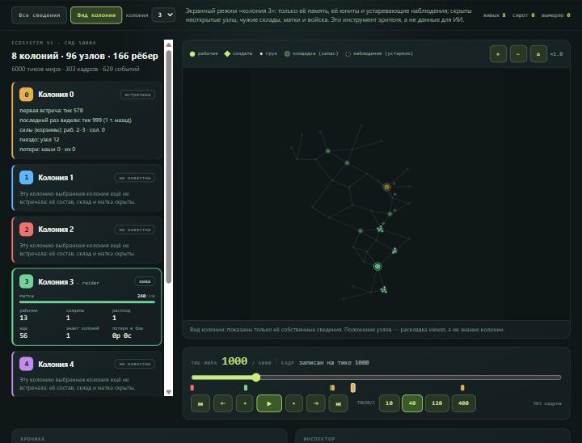

# FOR-47 — viewer Ecosystem v1 (E2-a): replay реального прогона, карта, события

Локальный offline-viewer на Vue 3 / TypeScript, который проигрывает **настоящий** прогон `step_world_tick` из E1. Фронтенд ничего не симулирует: он читает файл, проверяет его и показывает записанные кадры и события. Старый viewer L0 остаётся нетронутым и доступен по `#/l0`.

## Запуск

```bash
cd viewer
npm ci
npm run dev        # откроется Ecosystem v1; пример seed 50004 загружается из public/samples
```

Кнопка **«Открыть файл»** читает локальный `.jsonl` в браузере, ничего не отправляется в сеть. Повреждённый файл оставляет на экране предыдущий replay и показывает причину. Параметры адреса: `?tick=2622&colony=3&view=colony` открывают нужный тик и режим.

Пример: [`viewer/public/samples/eco_seed50004_raider3.jsonl`](../viewer/public/samples/eco_seed50004_raider3.jsonl) — 8 колоний, moderate, seed 50004, колония 3 — `raider`, 6000 тиков, 3.3 МБ, 303 кадра, 629 событий.

## Экспорт из Python

```bash
python -m formicmind.eco replay-export --seed 50004 --colonies 8 --scenario moderate --role 3=raider --ticks 6000 --frame-every 20 --verify --out run.jsonl
python -m formicmind.eco replay-verify run.jsonl            # строгое чтение + полный повторный прогон, байт в байт
python -m formicmind.eco replay-verify --read-only run.jsonl
```

Файл формата `formicmind.eco.replay/1` — JSONL, одна canonical-JSON запись на строку, у каждой есть `seq` и `chain` (SHA-256 от предыдущей цепочки и записи). Записи: `header` (seed, роли, config и `config_hash`, полная карта и `map_hash`, раскладка строк), затем события и кадры в порядке исполнения, в конце `result` (исходы, `events_hash`, финальные `state`/`checkpoint` hash, счётчики). Файл не содержит часов и окружения: один seed, config и набор ролей дают **одни и те же байты**. Новый код — `src/formicmind/eco/replay_file.py`.

* **События** пишутся целиком (никакой выборки): `discover, contact, nest_found, dispatch, combat, death, queen_damage, queen_dead, collapse, extinct`.
* **Кадры** — состояние *после* `tick` завершённых тиков: истинные запасы площадок и кучи, колонии (статус, матка, рабочие, солдаты, расплод, еда), все когорты (id, колония, каста, численность, HP, груз, задача и фаза, узел или ребро с настоящими `depart`/`arrive`) и **приватная память каждой колонии** (посещённые узлы с давностью и последним виденным запасом, узлы, о которых она только знает, встреченные колонии, наблюдения). Кадры пишутся каждые `--frame-every` тиков, на старте, в конце и сразу после гибели матки, коллапса или вымирания.
* Между кадрами ничего не придумывается: viewer двигает когорты по ребру **только** по записанным `depart`/`arrive`; после конца поездки или для когорты, стоящей в узле на момент кадра, показывается положение из кадра с пометкой «между кадрами позиции вне рёбер не записаны» (полупрозрачный маркер).

## Что показывает viewer

* Карта 96 узлов и 166 рёбер: все 8 гнёзд (цвет колонии, ✝ у погибшей матки), пищевые площадки с актуальным запасом (заполнение), кучи еды, рабочие (круги) и солдаты (ромбы), размер — число юнитов, белая точка — груз, красное кольцо — миссия `attack`, пунктирное — `scout`. Pan/zoom: колесо, перетаскивание, кнопки.
* Воспроизведение в **тиках мира**: play/pause, 10/40/120/400 тиков/с, шаг по кадрам, ползунок, переход к предыдущему/следующему ключевому моменту (первая встреча, найденное гнездо, первая атака, первый бой, гибель матки, вымирание); маркеры ключевых моментов на шкале.
* Панель колоний: рабочие, солдаты, расплод, еда, статус (`жива` / `сирота` / `вымерла`), HP матки, сколько колоний знает, потери в бою (из `death`-событий).
* Лента событий с фильтрами по типу и колонии; клик переносит на тик после события и подсвечивает узел на карте. Инспектор узла.
* Переключатель **«Все сведения» / «Вид колонии»**. Второй режим — экранный режим исследователя, а не данные для ИИ: показаны только память выбранной колонии (посещённые узлы, узлы, о которых она «слышала», известные рёбра), её собственные юниты и устаревающие наблюдения чужих. Неоткрытые узлы, чужие склады, матки, составы и положения скрыты; сведения старше текущего тика помечены как исторические (возраст в тиках), а нераскрытые колонии в панели подписаны «не известна». Раскладка узлов на экране — свойство viewer, не знание колонии.




## Что проверяется и где

Браузер сам проверяет: ASCII/LF/canonical-вид каждой строки, `seq`, цепочку SHA-256, версию схемы, `config_hash`, `map_hash`, `events_hash` (пересчёт по записям событий), форму каждого кадра и когорты, согласованность счётчиков `result`. Он **не** пересчитывает `state_hash` и не повторяет симуляцию — это делает `replay-verify` в Python (повторный прогон должен дать тот же файл). Ошибки импорта читаются по-русски: пустой или обрезанный файл, BOM/CRLF, нарушенная цепочка, неизвестная версия, несовпадение хэшей, нарушенные поля.

Тесты: `viewer/src/eco/*.spec.ts` (парсер на настоящем файле и сверка с Python-отчётом — тот же `events_hash`, числа событий, гибель матки, атаки; fail-closed на правках с пересчитанной цепочкой; время и кадры; контрфактуальные тесты режима колонии: изменение скрытых фактов не меняет вид; компонент: загрузка, переход к событию, режим колонии, сломанный файл) и `tests/test_eco_replay_file.py` (запись и чтение кадра, побайтная воспроизводимость, разделение «известно / истинно» в памяти кадра, строгий читатель, повторный прогон, опубликованный файл и CLI). Измерено в браузере встроенной панели на файле 6000 тиков: воспроизведение на 400 тиков/с держит 396 тиков/с, максимальный интервал между задачами 18 мс (153 маркера когорт в режиме «Все сведения», меньше — в режиме колонии).

## Ограничения

* Частота кадров по умолчанию 20 тиков: положение когорт между кадрами известно только для идущих по одному ребру; траектории внутри интервала не восстанавливаются.
* Память колонии в файле — снимок слотов в виде `мировой id → сведения`; идентификаторы колоний в режиме колонии — подписи для зрителя.
* Не сделано: PPO, `ObservationE1`/`ActionE1`, replay-проверка по контрактам `eco-replay/v1` (§10.2 содержит `decision`-записи; их нет, пока нет агента), правки физики и баланса.
